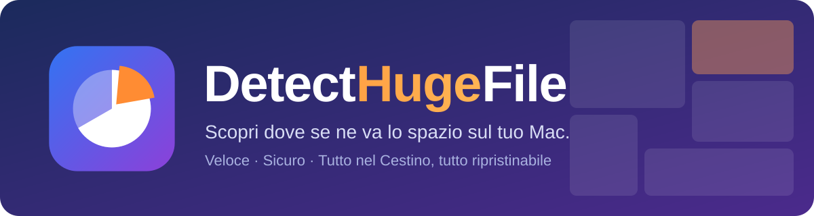

<div align="center">



<br>

[](https://github.com/RedsAnDev/OpenWare-DetectHugeFile/releases)
[](https://github.com/RedsAnDev/OpenWare-DetectHugeFile/releases)
[](LICENSE)


[](https://github.com/RedsAnDev/OpenWare-DetectHugeFile/commits/main)
[](https://github.com/RedsAnDev/OpenWare-DetectHugeFile/issues)
[](https://github.com/RedsAnDev/OpenWare-DetectHugeFile/pulls)

**[⬇️ Scarica](https://github.com/RedsAnDev/OpenWare-DetectHugeFile/releases/latest)** ·
**[✨ Funzioni](#-perché-detecthugefile)** ·
**[🗂️ Le tab](#-le-tab)** ·
**[🤖 Server MCP](#-server-mcp-uso-da-claude)** ·
**[🛠️ Compilare](#da-sorgenti)**

</div>

---

## ✨ Perché DetectHugeFile

App nativa per macOS che mostra **dove se ne va lo spazio su disco** e aiuta a recuperarlo in fretta:
cartelle più pesanti, artefatti di build, cache note, duplicati, container, Homebrew e altro.

| | |
|---|---|
| ⚡ **Veloce** | Scanner parallelo basato su `getattrlistbulk`: dimensioni identiche a `du`, 2–3 volte più veloce (circa 1 s per 190.000 file, 40 s per una home da 5 milioni di file). |
| 🛟 **Sicuro** | Nessuna cancellazione definitiva dei file: tutto passa dal **Cestino** ed è **ripristinabile**. Solo lettura finché non confermi un'azione, con **modalità a secco**. |
| 🧠 **Intelligente** | Riconosce gli artefatti dal file manifest accanto, protegge i progetti attivi e le versioni attive di nvm/pyenv/rustup. |
| 🗺️ **Visivo** | Albero con barre colorate, treemap interattiva, confronto fra scansioni per vedere cosa è cresciuto. |
| 🤖 **Integrato con Claude** | Server **MCP** incluso: Claude analizza il disco e propone pulizie, ma cancella solo con la tua conferma. |
| 🪶 **Leggero** | 100% Swift, nessuna dipendenza esterna, nessuna telemetria. |

> **Requisiti:** macOS 13 o successivo. Per compilare servono Xcode o i Command Line Tools (Swift 5.9+).

## 📑 Indice

[Installazione](#installazione) ·
[Permessi](#permessi) ·
[Le tab](#-le-tab) ·
[Sicurezza](#sicurezza-e-annullamento) ·
[Riga di comando](#uso-da-riga-di-comando) ·
[Server MCP](#-server-mcp-uso-da-claude) ·
[Release](#creare-e-pubblicare-una-release) ·
[Struttura](#struttura-del-progetto) ·
[Contribuire](#-contribuire) ·
[Licenza](#licenza)

---

## Installazione

### Da DMG (consigliato)

1. Scarica `DetectHugeFile-<versione>.dmg` dalla pagina **Releases**.
2. Apri il DMG e trascina **DetectHugeFile** in **Applicazioni**.
3. Se l'app non è notarizzata, al primo avvio macOS la blocca. Aprila con clic destro → **Apri**,
   oppure da Terminale:
   ```bash
   xattr -dr com.apple.quarantine /Applications/DetectHugeFile.app
   ```

Per verificare l'integrità del download:
```bash
shasum -a 256 -c DetectHugeFile-<versione>.dmg.sha256   # dalla cartella che contiene il DMG
```

### Da sorgenti

```bash
./build_app.sh --open        # compila, crea DetectHugeFile.app e la apre
```

---

## Permessi

| Permesso | A cosa serve | Come concederlo |
|---|---|---|
| **Accesso completo al disco** | Vedere Mail, Safari, Cestino, backup iPhone. Senza, queste cartelle risultano "accesso negato". | Impostazioni di Sistema → Privacy e sicurezza → Accesso completo al disco. Dal menu **⋯** → *Accesso completo al disco…* si apre direttamente la schermata. |
| **Automazione → Finder** | Svuotare il Cestino. | Richiesto al primo utilizzo. |
| **Volumi rimovibili** | Scansionare dischi USB/SD. | Richiesto da macOS al primo utilizzo. |
| **Amministratore** | Solo per eliminare snapshot Time Machine (tab Sistema). | Password richiesta al momento. |

---

## 🗂️ Le tab

La barra in alto contiene le tab (al centro) e le azioni della tab corrente (a destra). Le ultime due icone
sono sempre **Ripristina** e il menu **⋯**.

### Lista
Albero di tutte le cartelle con dimensione aggregata, numero di file, data di modifica e di creazione.
Ordinabile per ogni colonna. La barra colorata mostra il peso rispetto alla cartella padre.

- **Elenco piatto**: tutte le cartelle in un'unica lista ordinata per dimensione, con soglia minima e ricerca.
- **File grandi**: mostra anche i singoli file da 10 MB in su.
- **Cartella** (icona): home, una cartella a scelta, oppure un **disco** (interno, USB, SD).
- Etichette verdi sulle cartelle tipicamente rigenerabili (`node_modules`, `DerivedData`, `Caches`…).
- Tasto `Canc` o `⌘⌫`: sposta la selezione nel Cestino, dopo una conferma con il totale.
- Doppio clic: apre/chiude la cartella. Clic destro: Finder, copia percorso, scansiona solo questa cartella.

### Mappa
Treemap a blocchi proporzionali alle dimensioni, sulla scansione della tab Lista.
Passa il mouse per i dettagli, doppio clic per entrare in una cartella, clic destro per le azioni.

### WellKnown
I "colpevoli noti" di macOS, con dimensione misurata dal vivo: cache utente, log, DerivedData, simulatori,
cache di npm/Gradle/Maven/Cargo, modelli AI, ecc. Ogni voce ha una nota e un livello di rischio
(*sicuro* / *attenzione*). Le voci con rischio o che richiedono privilegi sono solo informative.
*Seleziona sicure* + *Pulisci selezionate* per un recupero rapido.

### Artefatti
Cerca nei tuoi progetti le cartelle rigenerabili, riconosciute dal file manifest accanto
(`package.json`, `Cargo.toml`, `pubspec.yaml`…), non solo dal nome:

| Tipo | Cartelle |
|---|---|
| Node / Bun / Hono | `node_modules`, `.next`, `.nuxt`, `.svelte-kit`, `.output`, `.turbo`, `dist`, `build`, `.wrangler`, `.vercel` |
| Rust | `target` |
| Flutter | `build`, `.dart_tool`, `ios/Pods`, `android/.gradle` |
| Python | `.venv`, `venv`, `.tox`, `.pytest_cache`, `.mypy_cache`, `build`, `dist` |
| Java/Gradle | `build`, `.gradle`, `target` (Maven) |
| Swift | `.build`, `Pods` |
| Go / Altri | `vendor`, `_build`, `deps`, `bin`/`obj` (.NET) |
| Versioni | versioni di Node (nvm, fnm), Python (pyenv), Rust (rustup). **La versione attiva è protetta.** |

Include le cache globali (npx, Bun, Cargo, pub, pip, uv, Go, Gradle).
Filtro per tipo, per età ("non toccati da 90 giorni") e ricerca.

**Protezione dei progetti attivi:** prima di cancellare, l'app controlla se ci sono processi in esecuzione
nel progetto o modifiche Git non committate, e ti avvisa.

### Duplicati
Trova file identici: prima per dimensione, poi hash parziale (primo MB), poi hash SHA-256 completo.
*Auto-selezione* tiene la copia più vecchia, più recente o dal percorso più corto. **Almeno una copia per
gruppo resta sempre**: l'app rifiuta di cancellarle tutte.

> I cloni APFS condividono lo spazio su disco e vengono comunque segnalati come duplicati.

### Container
Docker, Podman e minikube: container, immagini, volumi, profili minikube e **disco della VM di Podman**
(la dimensione realmente occupata sul Mac).

- Se il CLI `docker` è collegato al socket di Podman, i dati non vengono duplicati.
- I volumi sono marcati *dati*: contengono database e dati persistenti.
- *Pulizia*: prune di container, immagini, volumi, cache di build, con stima dello spazio recuperabile.
- *Compatta disco VM Podman*: esegue `fstrim` nella VM per restituire a macOS i blocchi liberi.
  Il disco di una VM non si restringe da solo quando elimini immagini al suo interno.

### Homebrew
Formule e cask installati con dimensione. Distingue *installata da te*, *dipendenza* e *dipendenza orfana*.
Le formule richieste da altre sono bloccate. Include **Cleanup** e **Autoremove** con stima dello spazio liberato.

### Storico
Ogni scansione della tab Lista salva un'istantanea (cartelle ≥ 20 MB). Confronta due istantanee per vedere
**cosa è cresciuto** tra una scansione e l'altra. Servono almeno due scansioni della stessa cartella.

### Sistema
Simulatori Xcode (con data dell'ultimo avvio), backup iPhone/iPad e snapshot locali di Time Machine.

---

## Sicurezza e annullamento

- **Cestino, non `rm`**: file e cartelle vengono spostati nel Cestino. Il pulsante **Ripristina** rimette
  l'ultimo lotto di elementi nel percorso originale (finché sono ancora nel Cestino).
- **Modalità a secco** (menu ⋯): ogni azione distruttiva mostra solo cosa succederebbe, senza toccare nulla.
- **Percorsi protetti**: Home, Library, Desktop, Documents, Downloads, `/System`, `/Users` e le radici dei
  volumi non possono essere cancellati dall'app.
- Non passano dal Cestino, e quindi **non sono ripristinabili**: simulatori, snapshot Time Machine,
  oggetti Docker/Podman, pacchetti Homebrew, svuotamento del Cestino. Le conferme lo dicono esplicitamente.
- Lo spazio si libera davvero solo **svuotando il Cestino** (pulsante dedicato).

Altre funzioni:
- **Esporta** CSV o Markdown della tab corrente (menu ⋯).
- **Promemoria mensile**: un LaunchAgent (`~/Library/LaunchAgents/dev.rossiandrea.DetectHugeFile.check.plist`)
  controlla il primo del mese e notifica se ci sono molti artefatti vecchi. Si disattiva dallo stesso menu.
- **Icona nella barra dei menu**: spazio libero, dischi esterni con *Espelli*, svuota Cestino.

---

## Uso da riga di comando

L'eseguibile accetta alcune modalità senza interfaccia, utili per test e script:

```bash
DetectHugeFile.app/Contents/MacOS/DetectHugeFile --scan ~/Workspace --top 20   # cartelle più pesanti
DetectHugeFile.app/Contents/MacOS/DetectHugeFile --artifacts ~/Workspace       # artefatti di progetto
DetectHugeFile.app/Contents/MacOS/DetectHugeFile --dups ~/Downloads            # duplicati (≥ 1 MB)
DetectHugeFile.app/Contents/MacOS/DetectHugeFile --known                       # dimensioni dei colpevoli noti
DetectHugeFile.app/Contents/MacOS/DetectHugeFile --containers                  # Docker / Podman / minikube
DetectHugeFile.app/Contents/MacOS/DetectHugeFile --brew                        # riepilogo Homebrew
DetectHugeFile.app/Contents/MacOS/DetectHugeFile --check --no-notify           # controllo del promemoria
DetectHugeFile.app/Contents/MacOS/DetectHugeFile --mcp                         # server MCP su stdio (vedi sotto)
```

Sono tutte di **sola lettura**. Il vecchio script `detect_huge_files.sh` resta disponibile come report testuale.

---

## 🤖 Server MCP (uso da Claude)

L'eseguibile include un server **MCP** (Model Context Protocol) su stdio, così Claude può analizzare il disco e
proporre pulizie con i tuoi stessi motori di scansione. Si registra una volta:

```bash
claude mcp add detecthugefile -- /Applications/DetectHugeFile.app/Contents/MacOS/DetectHugeFile --mcp
```

Poi, in una sessione di Claude Code, puoi chiedere ad esempio *"dove sta andando lo spazio sul mio Mac?"*,
*"quali artefatti non tocco da 3 mesi?"* o *"recuperami 10 GB senza rischi"*.

| Strumento | Cosa fa | Modifica il disco |
|---|---|---|
| `list_volumes` | Dischi montati (interni, USB, SD) con spazio libero | no |
| `scan_folders` | Cartelle più pesanti di un percorso o volume; salva un'istantanea | no |
| `find_artifacts` | `node_modules`, `target`, `build`, `.venv`… più cache globali e versioni dei gestori (l'attiva è `locked`) | no |
| `find_duplicates` | Duplicati reali (SHA-256 completo) | no |
| `known_offenders` | I "colpevoli noti" di macOS con rischio e modo di pulizia | no |
| `containers_summary` | Docker, Podman, minikube, disco della VM di Podman | no |
| `brew_summary` | Formule/cask più pesanti, stima cleanup, dipendenze orfane | no |
| `compare_snapshots` | Cosa è cresciuto fra due scansioni | no |
| `plan_cleanup` | Piano con motivazione e rischio per ogni voce; con `goal_gb` suggerisce una selezione | **no** |
| `trash_paths` | Sposta nel Cestino i percorsi indicati | **sì, solo con la tua conferma** |
| `restore_last` | Annulla l'ultima pulizia (anche quella fatta dall'app) | ripristina |

**Come è protetto `trash_paths`**
- Appare una **finestra di sistema** costruita dal server con i percorsi reali e le dimensioni, più il motivo dichiarato da
  Claude. Claude non la vede e non può rispondere al posto tuo. Se la rifiuti o non rispondi entro 180 s, non succede nulla.
- Va nel **Cestino** (mai `rm`) ed è registrato: `restore_last` o il pulsante *Ripristina* dell'app lo annullano.
- Rifiuta sempre: percorsi di sistema, cartelle utente di primo livello (Home, Documents, Desktop…), radici dei volumi,
  credenziali (`~/.ssh`, `~/.gnupg`, `~/.aws`, Keychains) e le versioni attive di nvm/pyenv/rustup/fnm. Massimo 50 percorsi per richiesta.
- Rispetta la **modalità a secco** dell'app.
- Non esistono strumenti per `docker prune`, `brew uninstall`, `simctl delete` o per svuotare il Cestino: restano manuali, nell'app.

**Permessi:** il server gira come processo figlio di chi lo avvia (Claude Code, il terminale). Se compaiono
`access_denied_dirs`, concedi l'*Accesso completo al disco* a quell'applicazione, non a DetectHugeFile.

Le scansioni grandi (home intera) richiedono circa un minuto; i risultati restano in cache 10 minuti nel processo.

---

## Creare e pubblicare una release

### 1. Generare il DMG

```bash
./make_dmg.sh -v 1.2.0         # solo l'architettura del tuo Mac
./make_dmg.sh -v 1.2.0 -u      # universale: arm64 + x86_64
```

Crea in `dist/`:
- `DetectHugeFile-1.2.0.dmg`
- `DetectHugeFile-1.2.0.dmg.sha256`

### 2. Firma e notarizzazione (distribuzione senza avvisi)

Senza firma Developer ID l'app è firmata solo in locale (*ad-hoc*) e chi la scarica dovrà autorizzarla a mano.
Per una distribuzione pulita serve un account **Apple Developer Program**.

**Una tantum**

1. Crea il certificato **Developer ID Application**: Xcode → Settings → Accounts → Manage Certificates → `+`.
2. Verifica che compaia:
   ```bash
   security find-identity -v -p codesigning
   ```
   Cerca una riga `Developer ID Application: Nome Cognome (TEAMID)`. I certificati *Apple Development*
   **non bastano**: servono solo per provare le app sui propri dispositivi.
3. Crea una **password specifica per l'app** su [account.apple.com](https://account.apple.com)
   (Accesso e sicurezza → Password specifiche per le app).
4. Salva le credenziali nel portachiavi:
   ```bash
   xcrun notarytool store-credentials "dhf-notary" \
     --apple-id "tuo@apple.id" --team-id "TEAMID" --password "xxxx-xxxx-xxxx-xxxx"
   ```

**A ogni release**

```bash
SIGN_IDENTITY="Developer ID Application: Nome Cognome (TEAMID)" \
NOTARY_PROFILE="dhf-notary" \
./make_dmg.sh -v 1.2.0 -u
```

**Verifica finale**

```bash
spctl --assess --type open --context context:primary-signature -v dist/DetectHugeFile-1.2.0.dmg
xcrun stapler validate dist/DetectHugeFile-1.2.0.dmg
```
Atteso: `accepted` e `source=Notarized Developer ID`.

### 3. Pubblicare su GitHub

```bash
git tag v1.2.0 && git push origin v1.2.0
gh release create v1.2.0 dist/DetectHugeFile-1.2.0.dmg dist/DetectHugeFile-1.2.0.dmg.sha256 \
  --title "DetectHugeFile 1.2.0" --generate-notes
```

---

## Struttura del progetto

```
Package.swift
build_app.sh            compila e crea DetectHugeFile.app (VERSION, ARCHS, SIGN_IDENTITY da ambiente)
make_dmg.sh             crea il DMG (firma e notarizzazione opzionali)
detect_huge_files.sh    vecchio report testuale da terminale
Tools/make_icon.swift   genera l'icona (AppIcon.icns)
assets/                 logo e banner (SVG) usati nel README
Sources/DetectHugeFile/
  Scanner.swift         scanner parallelo getattrlistbulk
  Node.swift            albero cartelle, ordinamento, aggregazione
  AppModel.swift        stato della tab Lista, scansioni, cestino
  OutlineView.swift     albero a colonne (NSOutlineView)
  Treemap.swift         mappa a blocchi (squarified treemap)
  WellKnown.swift       colpevoli noti
  Artifacts.swift       artefatti di progetto, versioni dei gestori
  Duplicates.swift      duplicati (SHA-256)
  Containers.swift      Docker / Podman / minikube
  Homebrew.swift        formule e cask
  History.swift         istantanee e confronto
  SystemTab.swift       simulatori, backup iOS, snapshot Time Machine
  Infra.swift           cestino con annulla, percorsi protetti, modalità a secco, volumi, esportazione, promemoria
  MCP.swift             server MCP (strumenti di analisi, plan_cleanup, trash_paths con conferma)
  App.swift             finestra, tab, barra dei menu
  main.swift            modalità da riga di comando
```

I dati dell'app (registro del Cestino, istantanee) sono in `~/Library/Application Support/DetectHugeFile/`.

---

## Limiti noti

- Le dimensioni sono **spazio allocato su disco** (come `du`), non la dimensione logica dei file.
- Le dimensioni delle immagini Docker/Podman condividono i layer: la somma può superare lo spazio reale.
- Su dischi non APFS (exFAT, FAT, NTFS, SMB) lo spazio allocato può non essere disponibile e l'app ripiega
  sulla dimensione logica.
- La scansione di `~/Library` è esclusa dalle tab Artefatti e Duplicati (non contiene progetti).
- Le dimensioni dei volumi Docker/Podman vengono da `system df -v` del motore, perché i dati stanno dentro la VM
  e non sono visibili dal filesystem del Mac. La dimensione dei singoli container non viene mostrata (è trascurabile
  rispetto a immagini e volumi).

---

## Licenza

Software libero, rilasciato con licenza **[GNU GPL v3](LICENSE)** (o successiva, a tua scelta).

Sei libero di usarlo, studiarlo, modificarlo e ridistribuirlo. Se distribuisci una versione modificata, devi
farlo con la stessa licenza e rendere disponibile il codice sorgente.

> Le versioni fino alla 1.1.0 incluse sono state pubblicate con licenza MIT e restano utilizzabili a quei termini.
> Dalle versioni successive vale la GPL v3.

Copyright © 2026 Andrea Rossi

---

## 🤝 Contribuire

Il progetto è vivo e le idee sono benvenute.

- 🐛 **Segnala un bug** o proponi una funzione aprendo una [issue](https://github.com/RedsAnDev/OpenWare-DetectHugeFile/issues).
- 🔧 **Invia una PR**: lavora sul branch `dev`, compila con `./build_app.sh` e prova le modalità da riga di comando
  (`--scan`, `--artifacts`…) prima di aprirla.
- 🧭 Regola d'oro: ogni azione che cancella deve passare dal **Cestino**, essere **ripristinabile** e rispettare la
  **modalità a secco**. Le eccezioni vanno dichiarate nella conferma all'utente.
- 🧩 Nuovi "colpevoli noti" o tipi di artefatto sono i contributi più semplici: vedi `WellKnown.swift` e `Artifacts.swift`.

<div align="center">

<sub>Fatto con ❤️ e Swift · <a href="https://github.com/RedsAnDev/OpenWare-DetectHugeFile/releases">Releases</a> · <a href="LICENSE">GPLv3</a></sub>

</div>

---
